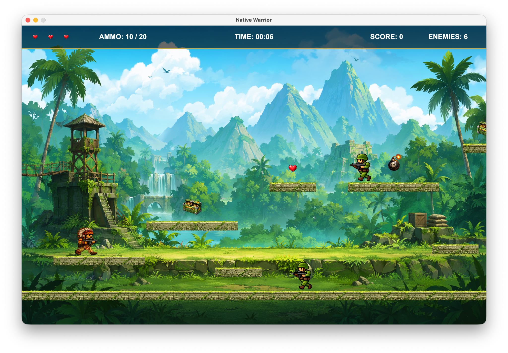
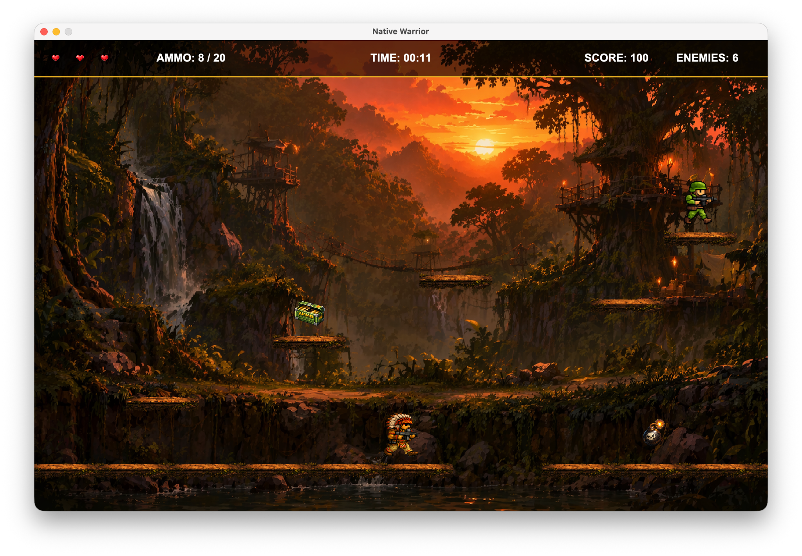
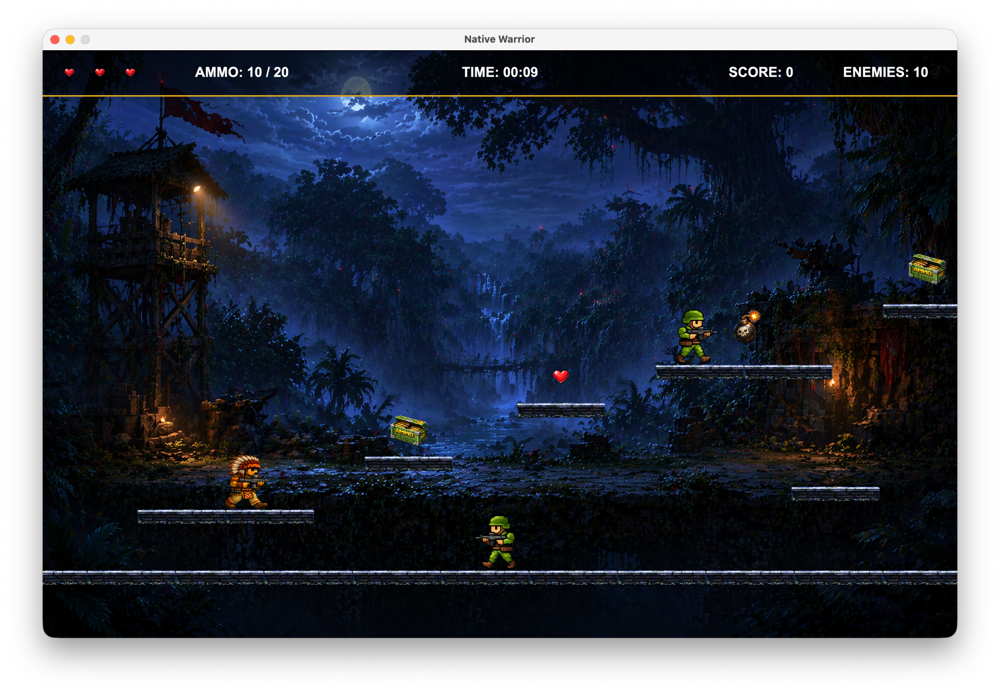
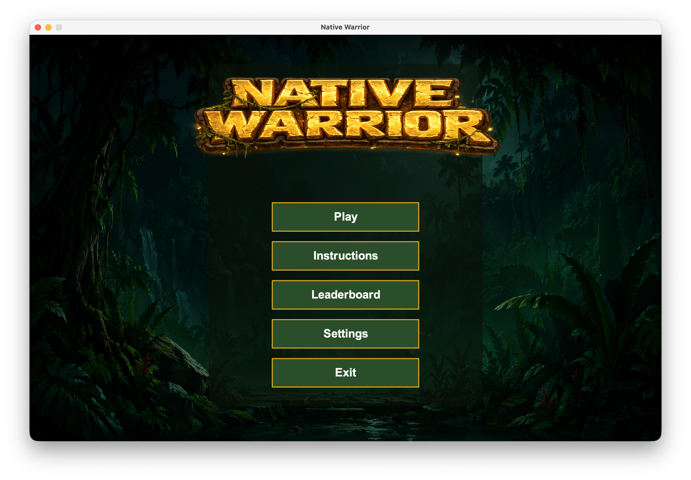
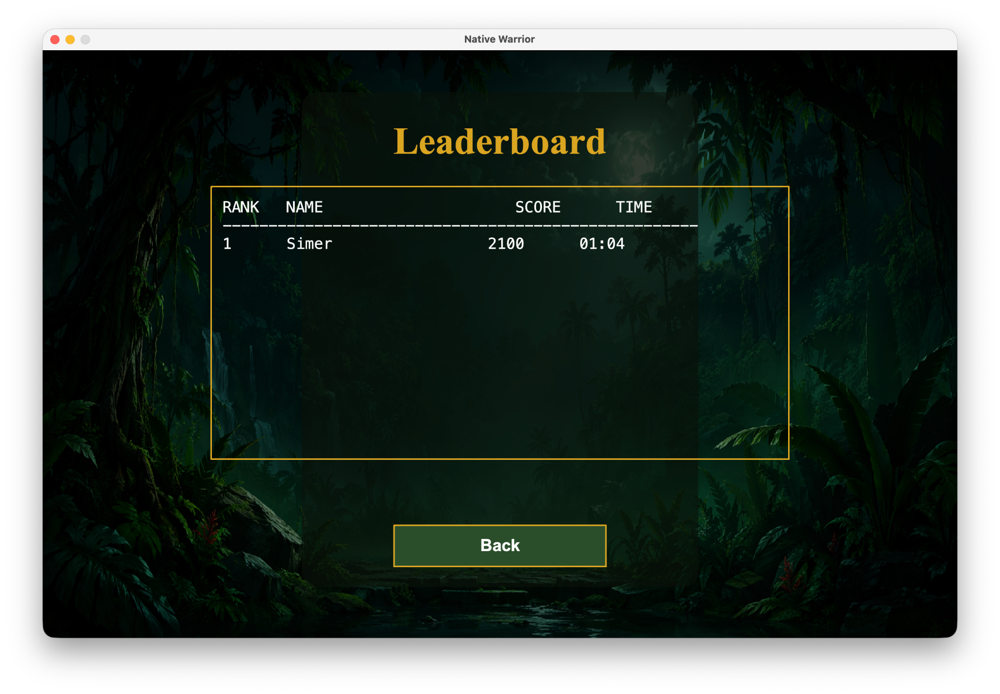

# Native Warrior Game

**A three-level Java 2D action-platformer developed with IntelliJ IDEA and the CityEngine physics library.**

Native Warrior challenges players to navigate platform-based levels, fight armed enemies, manage ammunition and health, and reach the end-of-level flag. The project combines Java object-oriented programming, collision-based gameplay, animated characters, audio, user-interface screens, and score tracking.

> [!IMPORTANT]
> **CityEngine is required to run this project.** The game depends on the external Java `city.cs.engine` library (configured as `CityEngine` in the IntelliJ module). **The library is not included in this repository.** Reviewers can browse the source code without it, but must obtain and configure a compatible CityEngine distribution and its dependencies to compile and play. This is **not a standalone executable**.

## Gameplay Showcase

### Level 1 — Jungle Warfare


The opening level introduces platform navigation, enemy encounters, ammunition management, health pickups and explosive hazards.

### Level 2 — Sunset Jungle


The second level features a distinct sunset environment, with further platform challenges, enemies and obstacles.

### Level 3 — Night Operations


The final level shifts to a moonlit jungle setting, challenging the player with additional enemies and hazards.

### Main Menu


The custom main menu provides access to Play, Instructions, Leaderboard, Settings and Exit.

### Persistent Leaderboard


Completed runs can be saved and ranked by score and completion time, with results stored locally between sessions.

## Features

- **Three levels** with distinct backgrounds, platforms, enemies, hazards and flag-based progression.
- **Combat:** player shooting, enemy projectiles, a limited magazine, reserve ammunition, manual reloading and ammunition pickups.
- **Movement:** left/right controls, double jump and moving platforms.
- **Enemies and hazards:** patrolling and stationary soldiers, enemy fire and explosive bombs.
- **Health and progress:** limited lives, health pickups, a score counter and elapsed-time tracking.
- **Persistent leaderboard:** saves player names, scores and completion times to `leaderboard.txt` and displays ranked results.
- **Menus and sound:** main menu, instructions, level selection, settings, adjustable volume, sound effects and music.

## Technologies

| Technology | Use |
| --- | --- |
| Java | Game logic and object-oriented application structure |
| CityEngine (`city.cs.engine`) | Physics bodies, world simulation and collision handling |
| JBox2D (`org.jbox2d`) | Vector and underlying physics types used by the game |
| Java Swing/AWT | Window, menus, input and interface elements |
| IntelliJ IDEA | Development and project configuration |

## How to Run

### Prerequisites

- A compatible **Java Development Kit (JDK)** and **IntelliJ IDEA**.
- The **CityEngine Java library**, including any dependencies distributed with it. Obtain these from your course resources or another authorised source. The project's `JavaGame.iml` refers to an application-level IntelliJ library named `CityEngine`, but does not bundle its JAR files.

### Installation

1. Clone the repository:

   ```bash
   git clone https://github.com/Gursimer-Dhaliwal/Native-Warrior-Game.git
   ```

2. Open the cloned folder in IntelliJ IDEA.
3. Configure a compatible JDK under **File → Project Structure → Project**.
4. Go to **File → Project Structure → Libraries → + → Java** and select the appropriate CityEngine JAR file(s). Attach the library to the project's module.
5. Ensure the `org.jbox2d` classes and other required dependencies are available.
6. Confirm that `src` is marked as a source root.
7. Run the **`game.Game`** class, which contains the application's `main()` method.
8. Ensure the working directory is the repository root so relative asset paths are resolved.

**Troubleshooting:** If IntelliJ displays `package city.cs.engine does not exist`, the CityEngine library has not been configured correctly. If `package org.jbox2d.common does not exist` appears, a required physics dependency is missing.

## Controls

| Key | Action |
| --- | --- |
| A / D | Move left / right |
| W | Jump / Double jump |
| Space | Shoot during gameplay; advance at level transitions |
| R | Reload |
| Esc | Return to the menu or handle the current screen |

Complete each level by defeating enemies and reaching the flag. Collect ammunition and hearts to maintain supplies and health.

## Project Structure

```text
Native-Warrior-Game/
├── src/game/
│   ├── Game.java
│   ├── MainMenu.java
│   ├── Level1.java
│   ├── Level2.java
│   ├── Level3.java
│   ├── LevelBuilder.java
│   ├── WASDMovement.java
│   ├── LeaderboardManager.java
│   └── ...
├── data/
├── screenshots/
│   ├── level-1.png
│   ├── level-2.png
│   ├── level-3.png
│   ├── main-menu.png
│   └── leaderboard.png
├── JavaGame.iml
├── leaderboard.txt
├── Use of AI.txt
└── README.md
```

## Code Highlights for Reviewers

- **Game.java:** Coordinates game states, level transitions, scoring and player lives.
- **LevelBuilder.java:** Constructs platforms, pickups, bombs, enemy placements and level objectives.
- **SoldierPatrol.java / SoldierShoot.java:** Implements enemy patrol and combat behaviour.
- **WASDMovement.java:** Handles keyboard controls, jumping, shooting and reloading.
- **LeaderboardManager.java:** Reads, writes and ranks player scores and completion times.

## Development Transparency

The repository contains a separate [Use of AI.txt](Use%20of%20AI.txt) declaration describing the use of ChatGPT as a learning and debugging aid during development. This includes explanations of Java concepts, implementation guidance and creative inspiration.

## Author

**Gursimer Dhaliwal**  
Computer Science Student  
City St George's, University of London

[GitHub Profile](https://github.com/Gursimer-Dhaliwal)
